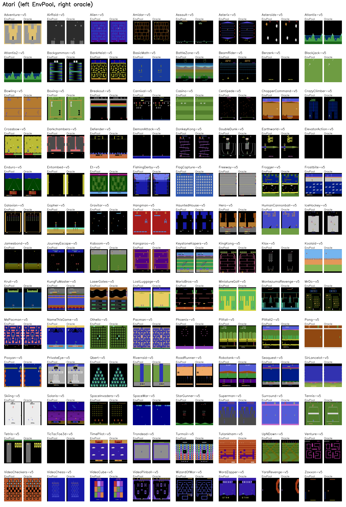

Atari
=====

We use the native Arcade Learning Environment ``0.11.2`` as the codebase.
See https://github.com/Farama-Foundation/Arcade-Learning-Environment/tree/v0.11.2

Render Compare
--------------

Representative first-frame compares for Atari tasks that support rendering. In
each panel, EnvPool is on the left and the exact raw-RGB oracle used by the
test suite is on the right.

Env Wrappers
------------

Currently it includes these wrappers: ``random-noops`` / ``fire-reset`` /
``episodic-life`` / ``frame-skip`` / ``action-repeat`` / ``image-resize`` /
``reward-clip``. The wrapper execution order is the same as
`OpenAI Baselines <https://github.com/openai/baselines/blob/master/baselines/common/atari_wrappers.py>`_.

Options
-------

* ``task_id (str)``: see available tasks below;
* ``num_envs (int)``: how many environments you would like to create;
* ``batch_size (int)``: the expected batch size for return result, default to
  ``num_envs``;
* ``num_threads (int)``: the maximum thread number for executing the actual
  ``env.step``, default to ``batch_size``;
* ``seed (int | Sequence[int])``: the environment seed. When a sequence is
  provided, it must contain exactly one seed per environment. Default to
  ``42``;
* ``max_episode_steps (int)``: the maximum number of steps for one episode,
  default to ``27000``, which corresponds to 108000 frames or roughly 30
  minutes of game-play (`Hessel et al. 2018, Table 3
  <https://arxiv.org/pdf/1710.02298.pdf>`_) because of the 4 skipped frames;
* ``img_height (int)``: the desired observation image height, default to
  ``84``;
* ``img_width (int)``: the desired observation image width, default to ``84``;
* ``stack_num (int)``: the number of frames to stack for a single observation,
  default to ``4``;
* ``gray_scale (bool)``: whether to use gray scale env wrapper, default to
  ``True``;
* ``mode (int)``: the ALE game mode to use, default to ``-1`` which keeps the
  game's built-in default mode;
* ``difficulty (int)``: the ALE game difficulty to use, default to ``-1``
  which keeps the game's built-in default difficulty;
* ``frame_skip (int)``: the number of frames to execute one repeated action,
  only the last frame would be kept, default to ``4``;
* ``noop_max (int)``: the maximum number of no-op action being executed when
  calling a single ``env.reset``, default to ``30``;
* ``episodic_life (bool)``: make end-of-life == end-of-episode, but only reset
  on true game over. It helps the value estimation. Default to ``False``;
* ``zero_discount_on_life_loss (bool)``: when the agent losses a life, the
  ``discount`` in dm_env.TimeStep is set to 0. This option doesn't affect gym's
  behavior (since there is no ``discount`` field in gym's API). Default to
  ``False``;
* ``reward_clip (bool)``: whether to change the reward to ``sign(reward)``,
  default to ``False``;
* ``repeat_action_probability (float)``: the action repeat probability in ALE
  configuration, default to 0 (no action repeat to perform deterministic
  result);
* ``use_inter_area_resize (bool)``: whether to use ``cv::INTER_AREA`` for
  image resize, default to ``True``.
* ``use_fire_reset (bool)``: whether to use ``fire-reset`` wrapper, default to
  ``True``.
* ``full_action_space (bool)``: whether to use the game's full legal ALE
  action set, normally 18 actions, default to ``False``. It does not change
  the continuous action space.
* ``continuous (bool)``: use native continuous actions, default to ``False``.
* ``continuous_action_threshold (float)``: continuous axis/fire threshold,
  default to ``0.5``; any finite value is accepted.

Observation Space
-----------------

The observation image size should be ``(stack_num, img_height, img_width)``,
``(4, 84, 84)`` by default. For a single frame, it has been gray-scaled and
resized inside the c++ code. The existing native Atari pipeline retains the
first 210 rows of ALE's image, including ROMs with taller original screens.
Native default rendering also uses this 210-by-160 crop. Oracle pixel
comparisons apply the same explicit crop to the original ALE image; the two
APIs do not have identical raw screen shapes for those games. In the pinned
ROM catalog, Adventure, AirRaid, KeystoneKapers, KingKong, Klax, LaserGates,
MrDo, Pacman, SirLancelot, and SpaceWar have 250 rows; Carnival has 214,
JourneyEscape has 230, and Pooyan has 220.

Action Space
------------

Each Atari game has its own discrete action space by default. With
``continuous=True``, every game instead exposes a float32 ``Box`` with shape
``(3,)`` and bounds ``[0, -pi, 0]`` to ``[1, pi, 1]``. The components are
joystick radius, joystick angle, and fire strength. Send batched actions with
shape ``(batch_size, 3)``. Separate typed native bindings keep the existing
integer action space unchanged when continuous mode is disabled.

Continuous actions follow the pinned ALE ``0.11.2``
`original Gymnasium wrapper conversion <https://github.com/Farama-Foundation/Arcade-Learning-Environment/blob/72a87826916aa0b696096c991faa982992ff80ec/src/ale/python/env.py#L279-L300>`_
and
`direction mapping <https://github.com/Farama-Foundation/Arcade-Learning-Environment/blob/72a87826916aa0b696096c991faa982992ff80ec/src/ale/python/env.py#L397-L453>`_.
The radius also passes directly to ALE as paddle strength. Conversion happens
once per external action; the same action and strength are used throughout
frame skipping, with ALE's ordinary sticky-action behavior.

That upstream version compares both sides of each Cartesian axis to the
*positive* threshold, rather than using a symmetric dead zone. This behavior
is preserved: at threshold ``0.5``, ``[0, 0, 0]`` means DOWNLEFT,
``[1, 0, 0]`` means DOWNRIGHT, and ``[0.5, 0, 0.5]`` means DOWN. Fire is
strictly greater than the threshold, so equality does not fire.

There is a narrow numerical compatibility limitation: native float32
``std::sin``/``std::cos`` and NumPy's float32 trigonometry can differ by one
unit in the last place. If the resulting axis lies exactly at a threshold,
that rounding can change the categorical ALE action. For example, with
NumPy ``2.4.3`` on the tested SIMD build, float32
``[0.6937808, 0.766001, 0]`` at threshold ``0.5`` produces DOWNRIGHT in
upstream and DOWN in the native implementation. NumPy builds and platforms
can differ. No epsilon or modified threshold is applied, and universal
bitwise conversion parity at these boundaries is not claimed. A separate
oracle characterization test records these cases without disguising the
difference as a numerical tolerance.

As a deliberate input-safety policy, native continuous pools reject
non-finite or out-of-Box actions and non-finite thresholds. The original
wrapper does not enforce those checks. Entire action batches are validated on
the caller thread before any slot is queued, so an invalid action cannot
partly advance a batch. All environment stepping remains native C++;
``ale-py`` is used only by the isolated tests.

Native Multi-Game Pools
-----------------------

``make_multitask`` can mix Atari games in one native ``AsyncEnvPool``. Each
slot keeps its assigned game across resets and owns an independent ALE emulator,
random generator, frame stack, lives, rewards, and episode counter. The games
share one worker pool and send/receive queue.

.. code-block:: python

    import envpool

    env = envpool.make_multitask(
        ["Pong-v5", "Breakout-v5", "SpaceInvaders-v5"],
        env_type="gymnasium",
        envs_per_task=[2, 3, 1],
        seed=[10, 11, 20, 21, 22, 30],
        batch_size=2,
        num_threads=3,
        full_action_space=True,
    )
    env.async_reset()
    obs, reward, terminated, truncated, info = env.recv()
    # Route the next actions using info["env_id"] in asynchronous mode.
    # info["task_id"] identifies the game independently of receive order.

Discrete mixed pools use the canonical 18-action ALE space; the helper enables
``full_action_space=True`` by default and rejects an explicit ``False``.
Equal minimal-action counts would not guarantee that action indices have the
same meaning in different games. ``LostLuggage-v5`` and ``Skiing-v5`` are
rejected from discrete mixed pools: ALE excludes FIRE variants from their legal spaces,
leaving nine legal actions. This follows the pinned
`LostLuggage action check <https://github.com/Farama-Foundation/Arcade-Learning-Environment/blob/72a87826916aa0b696096c991faa982992ff80ec/src/ale/games/supported/LostLuggage.cpp#L65-L80>`_
and
`Skiing action check <https://github.com/Farama-Foundation/Arcade-Learning-Environment/blob/72a87826916aa0b696096c991faa982992ff80ec/src/ale/games/supported/Skiing.cpp#L60-L75>`_.
LostLuggage explicitly
`documents that FIRE restarts the game <https://github.com/Farama-Foundation/Arcade-Learning-Environment/blob/72a87826916aa0b696096c991faa982992ff80ec/src/ale/games/supported/LostLuggage.hpp#L47-L48>`_.
Validation checks every selected game's actual ALE action values and ordering,
not a hardcoded game-name exclusion. Ordinary ``make`` calls retain each
game's minimal action space by default, and both games keep their existing
single-game behavior.

Continuous mixed pools support all 104 registered games, including
``LostLuggage-v5`` and ``Skiing-v5``, because they share the same three-value
Box. ``full_action_space`` does not restrict this mode. As in the original
wrapper, the converted action is passed directly to ALE; ALE maps forbidden
FIRE variants in those two games to NOOP. This follows its
`illegal-action handling <https://github.com/Farama-Foundation/Arcade-Learning-Environment/blob/72a87826916aa0b696096c991faa982992ff80ec/src/ale/environment/stella_environment.cpp#L141-L146>`_.
For example:

.. code-block:: python

    env = envpool.make_multitask(
        ["Pong-v5", "Breakout-v5", "LostLuggage-v5", "Skiing-v5"],
        continuous=True,
        envs_per_task=2,
    )

All slots share preprocessing settings, including resolution, color mode,
stacking, frame skipping, reward clipping, life-loss handling, random no-ops,
fire reset, sticky-action probability, mode, and difficulty. A selected mode or
difficulty must be valid for every game. Compatible complete observation and
action specs are checked before the pool is created. ``max_episode_steps`` is
measured in calls to ``step``, after the configured frame skipping.

``info["task_id"]`` (or ``timestep.observation.task_id`` with the dm_env API)
is a canonical integer from the sorted single-player ROM catalog pinned to ALE
``0.11.2``. Its value is independent of the requested games, their ordering,
slot counts, resets, and asynchronous completion order. ``env.task_ids`` lists
the requested public task names; ``env.env_task_ids`` lists the assigned public
name for every slot, in ``env_id`` order. Task IDs are also available in
ordinary single-game pools. The catalog is generated from the official ALE
ROM manifest by ``third_party/ale/generate_task_catalog.py``.
This native task-mapping contract is scoped to the 104 official registered
ROM names, including ordinary single-game pools. Unknown/custom ROM filenames
are rejected rather than assigned an unstable task ID; custom ROM registration
is not part of this catalog contract.

The native configuration fields ``env_task_names`` and
``env_max_episode_steps`` accept one ROM name and one positive episode limit
per slot. Empty vectors retain the scalar ``task`` and
``max_episode_steps`` behavior. Supplying ``env_task_names`` directly also
requires ``full_action_space=True`` in discrete mode. Most callers should use
``make_multitask`` to validate and expand the public registered task names.

The multitask regression suite compares observations, rewards, termination,
truncation, RAM, lives, elapsed steps, and rendered frames bitwise against
independently seeded single-game pools. It covers all 102 games with a
canonical 18-action space, verifies rejection and unchanged single-game
behavior for the two incompatible games, and tests partial resets,
asynchronous batches, different slot horizons, preprocessing options, and
sticky actions. The continuous suite additionally checks all 104 games
against the original ``ale-py==0.11.2`` Gymnasium wrapper, with pinned
Python 3.12, Gymnasium ``1.2.3``, and NumPy ``2.4.3`` in a test-only subprocess.
It compares raw RGB, RAM, rewards, lives, termination, truncation, and rendered
frames with no state synchronization after initial bootstrap alignment, plus
long paddle/FIRE trajectories. Wrapper combinations and asynchronous routing
are compared against independently seeded native single-game pools.

Available Tasks
---------------

**Note: Our Atari environments ALE settings follow gym's** ``*NoFrameSkip-v4``
(with openai/baselines wrapper) **instead of** ``*-v5`` by default, see the
related discussions at
`Issue #14 <https://github.com/sail-sg/envpool/issues/14>`_.

* ``Adventure-v5``
* ``AirRaid-v5``
* ``Alien-v5``
* ``Amidar-v5``
* ``Assault-v5``
* ``Asterix-v5``
* ``Asteroids-v5``
* ``Atlantis-v5``
* ``Atlantis2-v5``
* ``Backgammon-v5``
* ``BankHeist-v5``
* ``BasicMath-v5``
* ``BattleZone-v5``
* ``BeamRider-v5``
* ``Berzerk-v5``
* ``Blackjack-v5``
* ``Bowling-v5``
* ``Boxing-v5``
* ``Breakout-v5``
* ``Carnival-v5``
* ``Casino-v5``
* ``Centipede-v5``
* ``ChopperCommand-v5``
* ``CrazyClimber-v5``
* ``Crossbow-v5``
* ``Darkchambers-v5``
* ``Defender-v5``
* ``DemonAttack-v5``
* ``DonkeyKong-v5``
* ``DoubleDunk-v5``
* ``Earthworld-v5``
* ``ElevatorAction-v5``
* ``Enduro-v5``
* ``Entombed-v5``
* ``Et-v5``
* ``FishingDerby-v5``
* ``FlagCapture-v5``
* ``Freeway-v5``
* ``Frogger-v5``
* ``Frostbite-v5``
* ``Galaxian-v5``
* ``Gopher-v5``
* ``Gravitar-v5``
* ``Hangman-v5``
* ``HauntedHouse-v5``
* ``Hero-v5``
* ``HumanCannonball-v5``
* ``IceHockey-v5``
* ``Jamesbond-v5``
* ``JourneyEscape-v5``
* ``Kaboom-v5``
* ``Kangaroo-v5``
* ``KeystoneKapers-v5``
* ``KingKong-v5``
* ``Klax-v5``
* ``Koolaid-v5``
* ``Krull-v5``
* ``KungFuMaster-v5``
* ``LaserGates-v5``
* ``LostLuggage-v5``
* ``MarioBros-v5``
* ``MiniatureGolf-v5``
* ``MontezumaRevenge-v5``
* ``MrDo-v5``
* ``MsPacman-v5``
* ``NameThisGame-v5``
* ``Othello-v5``
* ``Pacman-v5``
* ``Phoenix-v5``
* ``Pitfall-v5``
* ``Pitfall2-v5``
* ``Pong-v5``
* ``Pooyan-v5``
* ``PrivateEye-v5``
* ``Qbert-v5``
* ``Riverraid-v5``
* ``RoadRunner-v5``
* ``Robotank-v5``
* ``Seaquest-v5``
* ``SirLancelot-v5``
* ``Skiing-v5``
* ``Solaris-v5``
* ``SpaceInvaders-v5``
* ``SpaceWar-v5``
* ``StarGunner-v5``
* ``Superman-v5``
* ``Surround-v5``
* ``Tennis-v5``
* ``Tetris-v5``
* ``TicTacToe3d-v5``
* ``TimePilot-v5``
* ``Trondead-v5``
* ``Turmoil-v5``
* ``Tutankham-v5``
* ``UpNDown-v5``
* ``Venture-v5``
* ``VideoCheckers-v5``
* ``VideoChess-v5``
* ``VideoCube-v5``
* ``VideoPinball-v5``
* ``WizardOfWor-v5``
* ``WordZapper-v5``
* ``YarsRevenge-v5``
* ``Zaxxon-v5``
